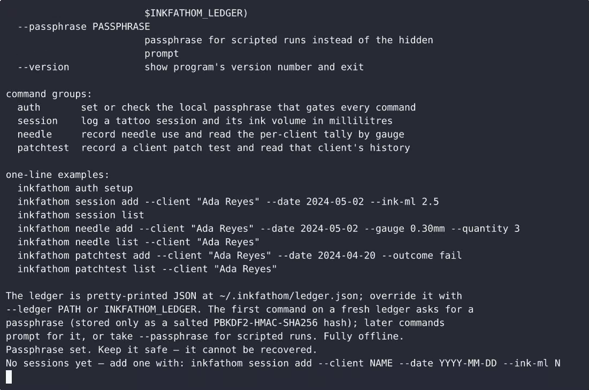
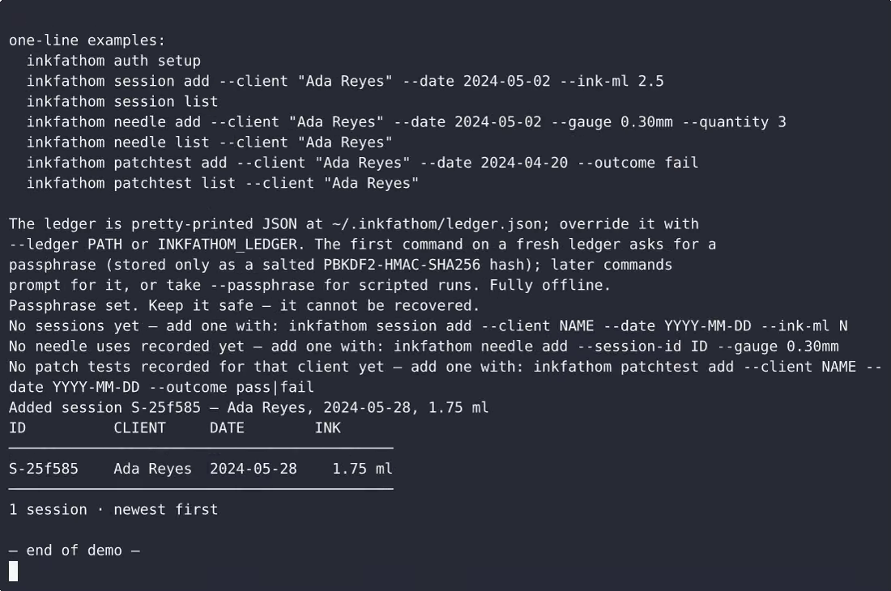

# InkFathom — complete Full-stack app command-line tool example app

Need a self-hosted command-line tool? **InkFathom** is the open-source answer: a Full-stack app project you can clone, run, and own. InkFathom is a single-file, standard-library-only Python command-line tool for a tattoo artist's studio bookkeeping: it records ink millilitres used per client session, tallies needle consumption by gauge, and keeps c…. Every InkFathom line of code is here — no stripped demo, no paywalled features. Apache-2.0-licensed; [remix InkFathom on cenius.ai](https://cenius.ai/marketplace/p/inkfathom?ref=gh&utm_campaign=inkfathom-webapp) for a bespoke custom version.


[](LICENSE)  [](https://cenius.ai)

[](https://cenius.ai/marketplace/p/inkfathom?ref=gh&utm_campaign=inkfathom-webapp)

> **▶ [Open & edit in cenius.ai](https://cenius.ai/marketplace/p/inkfathom?ref=gh&utm_campaign=inkfathom-webapp)** — one click to an editable workspace: describe changes in plain English, get an instant preview, one-click deploy and host. Modifications made on the platform come with full rebrand & relicense rights.

_Local clone? See [Quick start](#quick-start) below. cenius.ai is the zero-setup path._

## Demo


📽 **[Demo video on cenius.ai](https://cenius.ai/marketplace/p/inkfathom?ref=gh&utm_campaign=inkfathom-webapp)** — the complete run-through · [MP4](.github/media/demo.mp4)

## Screenshots

 

## Architecture

No external services required: the entire command-line tool runs from this Full-stack app repo (12 files). Run `./install.sh` once to install packages and populate demo data — the app is ready to use immediately after. See [`INSTALL.md`](INSTALL.md) for complete setup instructions.

## Features

- Ink volume per session ledger
- Needle gauge consumption tally
- Client patch test record

## Quick start

```bash
./install.sh   # installs dependencies + seeds demo data
```

See [`INSTALL.md`](INSTALL.md) for full setup and usage instructions.

## Usage guide

Every command is gated by the ledger passphrase: InkFathom prompts for it (hidden
input) unless you pass `--passphrase`. `--ledger PATH` and `--passphrase` are accepted
before *or* after the subcommand.

```bash
alias ink="python3 inkfathom.py"
```

### Sessions — ink volume per session

```bash
ink session add --client "Ada Reyes" --date 2024-05-02 --ink-ml 2.5
## Added session S-c59836 — Ada Reyes, 2024-05-02, 2.50 ml

ink session add --client "Marcus Bell" --date 2024-05-09 --ink-ml 1.25
## Added session S-7f515a — Marcus Bell, 2024-05-09, 1.25 ml
## WARNING: most recent patch test for Marcus Bell (2024-04-11) FAILED

ink session list
## ID          CLIENT       DATE        INK
## ──────────────────────────────────────────────
## S-7f515a    Marcus Bell  2024-05-09    1.25 ml
## S-c59836    Ada Reyes    2024-05-02    2.50 ml
## ──────────────────────────────────────────────
## 2 sessions · newest first

ink session list --json          # stable structured output for scripting
```

* The id is generated (`S-` plus six lowercase hex characters) and printed on add.
* `--ink-ml` must be greater than 0, at most 500, with at most 3 decimal places. It is
  stored as a decimal string (never a float) and rendered with 2 decimals, rounding
  half to even.
* `--date` must be a real calendar date written `YYYY-MM-DD`.
* `--client` is trimmed and must be 1–80 characters.
* Ordering is newest date first; two sessions on the same date fall back to the most
  recently added.

Empty ledger:

_Full guide: [`USAGE.md`](USAGE.md)_

## FAQ

### How do I get InkFathom running locally?

Pull the repo, run `./install.sh`, and you are up — the script installs packages and pre-seeds the database. [`INSTALL.md`](INSTALL.md) covers any platform-specific tweaks.

### Does the InkFathom license allow commercial use?

It is. Apache-2.0 licensing means you can build a product on it, sell it, or use it inside a company with no fees. Details: [LICENSE](LICENSE).

### Can I rebrand or white-label InkFathom?

Rebranding is straightforward under the MIT license — change what you want in the source. Or [open it on cenius.ai](https://cenius.ai/marketplace/p/inkfathom?ref=gh&utm_campaign=inkfathom-webapp): the platform handles the changes and grants full rebrand rights on the result.

### What if I want to add features to InkFathom without coding?

Yes — [load it on cenius.ai](https://cenius.ai/marketplace/p/inkfathom?ref=gh&utm_campaign=inkfathom-webapp), describe the change in plain English, and you get back a fresh build with your modification applied.

### How is InkFathom built technically?

The app is built with Full-stack app. What you see in this repo is the full production source, demo data included. Highlights include ink volume per session ledger.

## License & rebranding

Released under the [Apache License 2.0](LICENSE) (© 2026 Cenius AI) — free for personal and commercial use. The Cenius name/logo are trademarks (see NOTICE).

**Need a customized version?** [Remix this app on cenius.ai](https://cenius.ai/marketplace/p/inkfathom?ref=gh&utm_campaign=inkfathom-webapp) — modifications made on the platform come with **full rebrand & relicense rights** over your derivative.

## Built with cenius.ai

This entire application — code, design, seeded demo data — was generated on **[cenius.ai](https://cenius.ai)** from a plain-English description.

- 🚀 [Build your own app on cenius.ai](https://cenius.ai)
- 🎛️ [Remix InkFathom on the marketplace](https://cenius.ai/marketplace/p/inkfathom?ref=gh&utm_campaign=inkfathom-webapp) — open it in a workspace, prompt for changes, and ship your own version.

More open-source apps: [the Cenius-ai catalog](https://github.com/Cenius-ai) · [showcase index](https://github.com/Cenius-ai/showcase)
